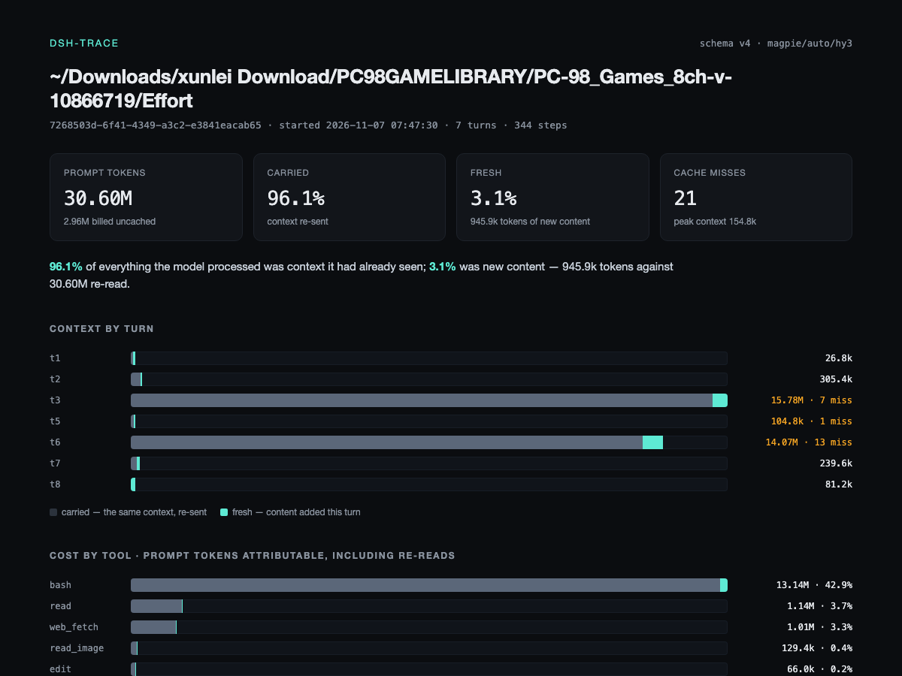
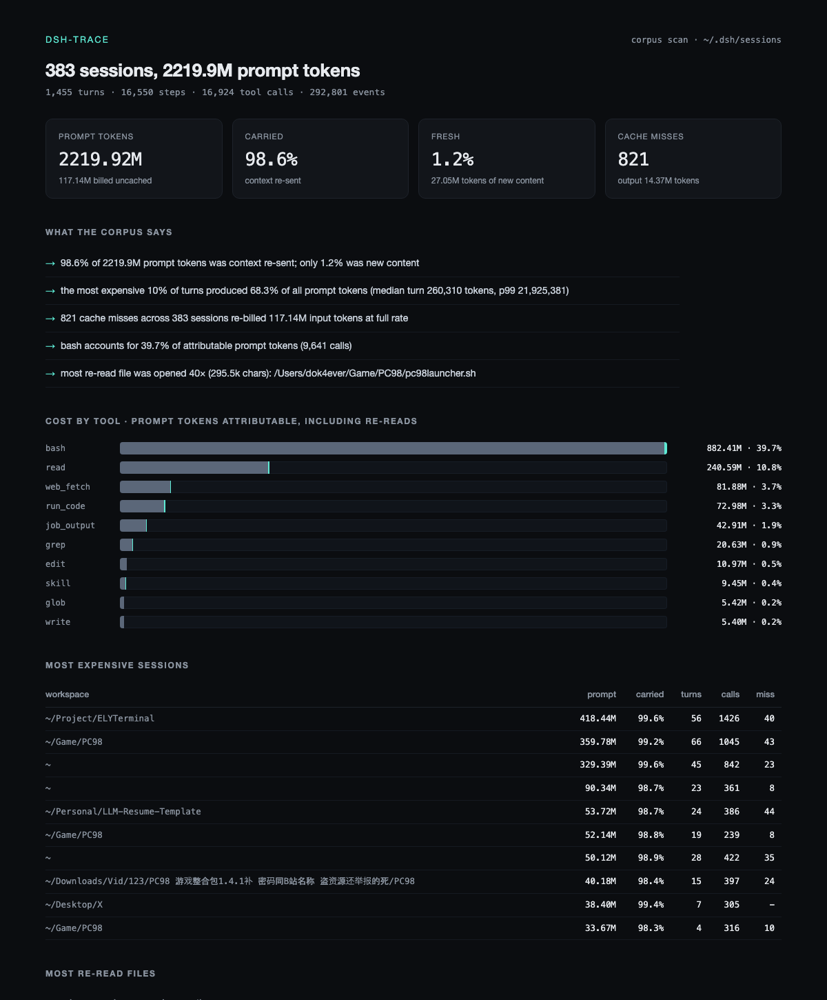

# dsh-trace

Offline trace, replay and diff for [DeepSeek Harness](https://github.com/deepseek-ai/deepseek-harness) agent sessions.



A DSH session is a compressed, append-only event log (`session.jsonl.zstd`, thousands of events per conversation). It holds everything that actually happened — every tool call, every tool result, every streamed reasoning chunk — and nothing reads it in full. `dsh-trace` turns that log into something you can inspect:

- **ingest** — decompress and normalize a session into a flat, versioned *tape*
- **report** — decompose every turn's prompt tokens into context re-sent (`carried`) versus new content (`fresh`), then attribute the new content back to the tools that produced it
- **replay** — re-execute side-effect-free tools (`read`, `glob`, `grep`) and report where the recording and the filesystem now disagree
- **diff** — align two runs of the same task on the tool-call sequence and show where the plan diverged, and where only the arguments drifted

Status: **pre-alpha, day 0.** The scope and the seven-day plan live in [TODO.md](./TODO.md) and [TASKS.md](./TASKS.md).

## Why

Agents are non-deterministic and their transcripts are write-only: when a run goes wrong, the evidence exists but there is no way to ask it questions. `dsh-trace` is the answer to "why did this turn cost 40k tokens" and "what changed between the run that worked and the run that did not", without adding a debugger to the harness itself.

Design constraint that makes it durable: it never patches the host. No `cordis.patch.yml` entries, no version probing, no reading other packages' manifests. It reads files that are already on disk, so a harness release cannot break it.

## Quick start

```sh
direnv allow          # or: nix develop
pnpm install
pnpm build
pnpm dsh-trace ingest ~/.dsh/sessions/<workspace>/<session-id>/session.v4.jsonl.zstd
pnpm dsh-trace report ~/.dsh/sessions/<workspace>/<session-id>/session.v4.jsonl.zstd
pnpm dsh-trace diff <a.jsonl.zstd> <b.jsonl.zstd>
pnpm dsh-trace html <session.jsonl.zstd> -o report.html [--diff <other.jsonl.zstd>]
```

`html` writes one self-contained file — no scripts, no external requests, opens
offline. It is the artifact meant to be shared: the screenshot above is one.

`report` answers the only question that matters about an expensive session: how
much of what the model processed was the same context being re-sent, and which
tool output was responsible for the rest.

```
prompt 30.60M · carried 29.42M (96.1%) · fresh 945.9k (3.1%) · uncached 2.96M (9.7%)
output 779.5k · unattributed 168.4k · chars→tokens 0.43 (n=284) · cache misses 21

turn  prompt  carried  fresh   steps  peak    miss  top tool
3     15.78M  15.39M   364.6k    158  154.8k     7  bash 6.66M
```

## Corpus scan

`dsh-trace scan <sessions-dir>` runs the same analysis over every session under a
directory and reports what keeps happening. On 383 local sessions (1,455 turns,
2.22B prompt tokens):



- **98.6% of everything the models processed was context they had already seen**;
  1.2% was new content.
- The most expensive **10% of turns produced 68.2%** of all prompt tokens
  (median turn 260k tokens, p99 21.9M, max 40.1M).
- 821 cache misses re-billed 117M input tokens at full rate.
- `bash` output accounts for 39.8% of attributable prompt tokens.
- The most re-read file was opened 40 times (295k characters).

```sh
dsh-trace scan ~/.dsh/sessions --html scan.html
```

## Requirements

- Node.js >= 24 — zstd decompression uses the built-in `node:zlib` (`zstdDecompressSync`), so there is no native dependency and no `zstd` binary at runtime.
- No network access. No credentials. Session logs are read locally and never uploaded.

## License

MIT
