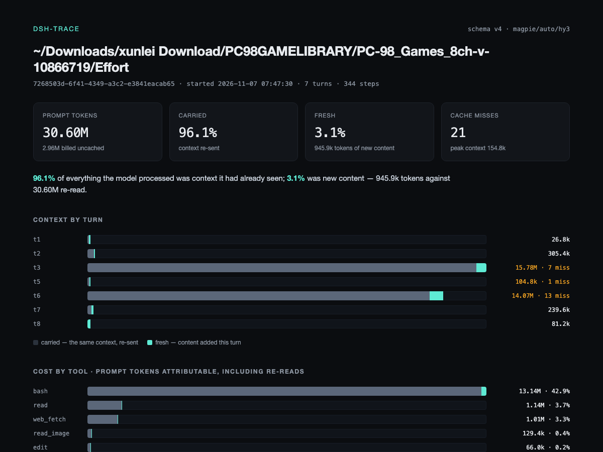
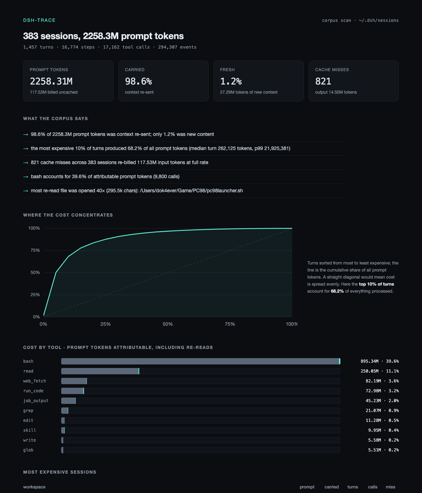

# 你的 agent 有 98.6% 的算力，花在重读它自己

我把本机 383 次 DeepSeek Harness 会话的日志全部解开数了一遍：**22.6 亿 prompt token 里，98.6% 是模型已经看过的上下文在被反复重发，只有 1.2% 是新内容。**

最贵的一轮（turn）单独吃掉了 4,000 万 prompt token。

这不是某个模型的毛病，是所有"把完整对话历史每步重发一遍"的 agent 的共同账本。区别只在于有没有人去数。



## 先把口径说清楚

会话日志是 zstd 压缩的 JSONL，一次会话几百到上万个事件，每个字段都在。麻烦的是那个叫 `inputTokens` 的字段——它**只是未命中缓存的输入**。真实上下文大小是 `inputTokens + cacheReadTokens`。

我第一版就是拿 `inputTokens` 当上下文大小，结果在缓存失效的那一步，输入从 327 跳到 650,764，工具归因表里 `bash` 被算成 557% 的账单。数字荒唐到一眼能看出不对，但它同时也说明：**缓存和上下文这两件事，在日志里是分开的，混着看必然算错。**

换成 prompt token 口径后，每一轮可以严格分解：

```
prompt = first + Σ carried + Σ fresh
carried = min(prompt_i, prompt_i-1)       // 同一份上下文被重发
fresh   = max(0, prompt_i - prompt_i-1)   // 这一步新增的内容
```

这个恒等式在全部 1,457 个 turn 上零误差——不是拟合出来的，是定义出来的。

## 四个发现

### 一、98.6% 是重发，1.2% 是新内容

383 次会话、1,457 轮、1.68 万个 step，累计 22.6 亿 prompt token：

| 项 | 数值 | 占比 |
| --- | --- | --- |
| 总处理量 | 2,262.0M | 100% |
| 重发的上下文（carried） | 2,230M | 98.6% |
| 新内容（fresh） | 27M | 1.2% |
| 未命中缓存、按全价计费 | 117.5M | 5.2% |

第三行必须单独说：**98.6% 不等于"98.6% 的钱"。** 大部分重发走的是缓存读，便宜得多。真正按全价算的是那 1.175 亿 token。但处理量是实打实的——它决定了延迟、决定了上下文窗口的消耗、决定了模型每一步要在多长的历史里找信息。

### 二、成本极度集中：最贵的 10% 的 turn，吃掉 68.3%

turn 成本的分布长这样：中位数 26 万 prompt token，p90 是 393 万，p99 是 2,192 万，最大值 4,012 万。



把 turn 按成本从高到低排，累计曲线几乎在第一格就立起来了。这意味着优化目标不是"把每次调用变便宜一点"——那 90% 的便宜 turn 加起来才 31.7%。真正该动的是那些跑了几十上百步的长回合：它们在每一步都把前面所有步骤的输出重新交一遍。

### 三、bash 输出占可归因成本的 39.6%，read 占 11.1%

工具归因要把"新增的 token"摊回到产生它的工具上，所以还带了重读放大：一个在第 3 步追加、第 160 步还在上下文里的工具输出，成本要乘上它被重读的次数。

结果 `bash` 一项占 39.6%，`read` 11.1%，其余每一项都不足 4%。原因很直接：**bash 的输出长度没有上限**。一次 `find`、一次 `grep -r`、一次构建日志，可能就是几千行。而 `read` 至少还有行号范围可以约束。

同一个文件在一次会话里被打开 40 次、累计 29.5 万字符——这是单个文件贡献的噪音，不是信息。

### 四、821 次缓存未命中，重算 1.175 亿 token

缓存命中时，重发几乎是免费的；未命中时，整个上下文按全价重算一遍。821 次未命中集中在少数会话里，通常发生在上下文被改写的时候：换模型、改系统提示、压缩历史、切换工具集。

这些动作在功能上都是合理的，但在成本上是**把整段历史重新买了一遍**。

## 能改的五件事

1. **给工具输出设上限。** 39.6% 的成本来自 bash，而 bash 的输出长度完全由命令决定。`| head -100`、只 grep 需要的路径、构建日志只留错误行——这些不是审美问题，是账单问题。
2. **长回合要切。** 成本随步数线性叠加，而且是"每步重发全部历史"的叠加。一个 160 步的回合，比把它切成 8 个 20 步的回合贵一个量级。
3. **别在会话中途改前缀。** 系统提示、工具定义、模型，这些都是缓存的前缀。改一次，后面全部重算。真要改，放在新会话开头。
4. **别重复读同一个文件。** 40 次、29.5 万字符，说明模型在反复确认同一件事——通常是因为它把之前读到的内容挤出了注意力，或者根本没记住。这类重复是可以从日志里直接抓出来的。
5. **用 prompt token 做预算，别用 output token。** 输出只占 0.6%（14.5M / 2,262M）。盯着输出长度做优化，等于盯着零头做优化。

## 局限

- 这是**一个人的 383 次会话**，不是全行业样本。数字会变，量级和结构不会。
- 归因是估计：字符数×校准比例（按会话自校准，中位数 0.43 tokens/char，p10–p90 为 0.32–0.61），解释不了的部分（压缩摘要、工具 schema 变更、换模型）单独记成 `unattributed`，不摊给任何工具。
- 缓存价格没有计入。所以"98.6%"说的是处理量，不是花费。真要算钱，得把 cache read 的单价乘进去。
- 会话日志只能证明"发生了什么"，不能证明"为什么"。归因给出的是候选解释，不是因果。

## 工具

上面所有数字都来自 `dsh-trace`，一个零依赖的 Node CLI：

```sh
dsh-trace scan ~/.dsh/sessions --html scan.html   # 语料汇总
dsh-trace report <session>                        # 单会话：成本花在哪
dsh-trace diff <a> <b>                            # 两次运行从哪里分叉
dsh-trace html <session> -o report.html           # 单文件报告，可分享
```

它不接管 agent、不打补丁、不改宿主：只读磁盘上已经存在的日志。上游两天一个版本也砸不到它——这是它能长期活下来的原因，不是实现细节。

383 份语料扫一遍 2 秒。报告是单文件 HTML，断网能开。

## 最后

我们习惯用"输出质量"评价 agent，用"输出长度"估算成本。这份数据说，两件事都看错了位置：**成本在输入的重复里，而重复发生在每一步。**

下一步值得做的不是更聪明的提示词，是给 agent 一个"上下文预算"的概念——像内存一样，知道谁在占、占了多少、什么时候该回收。
